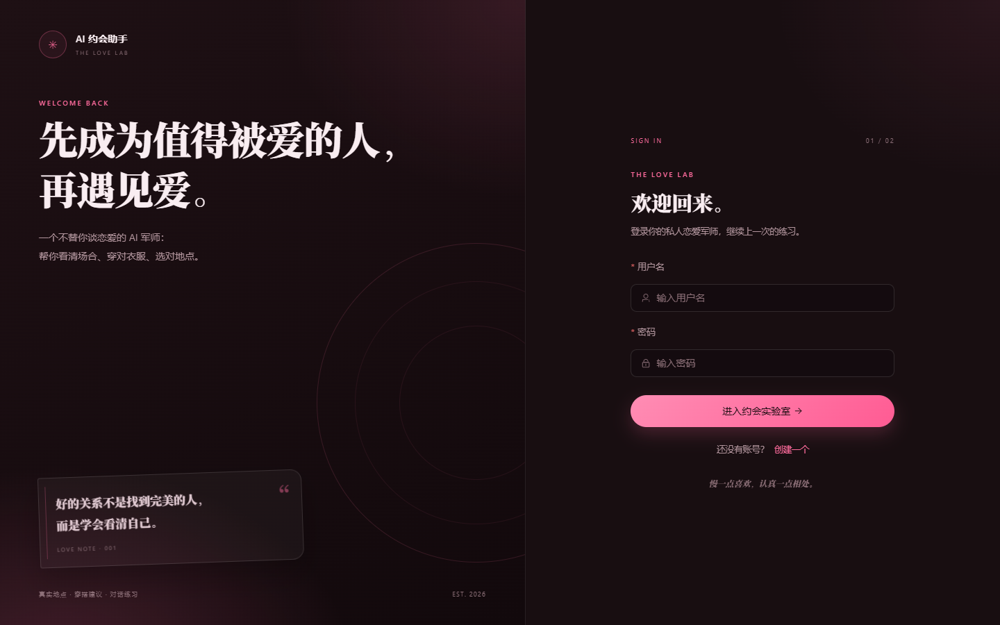
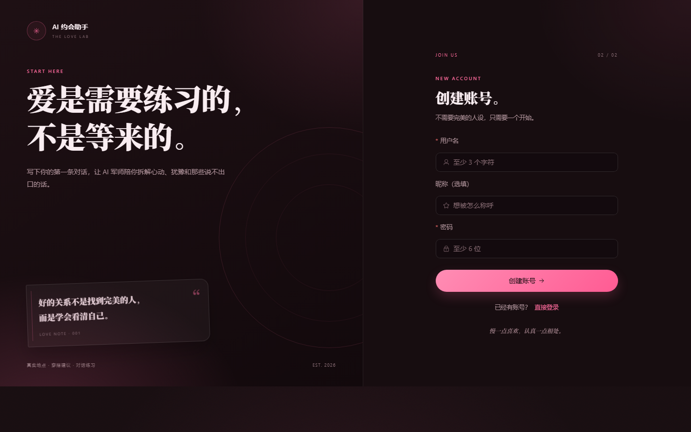
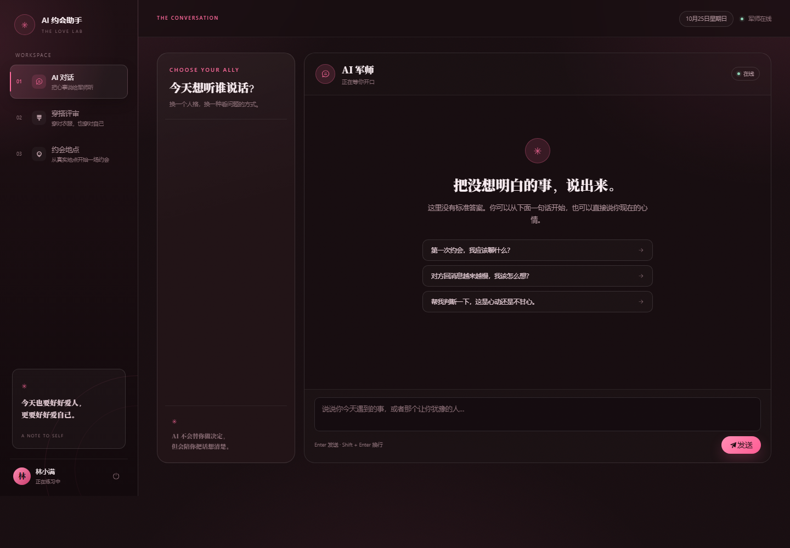
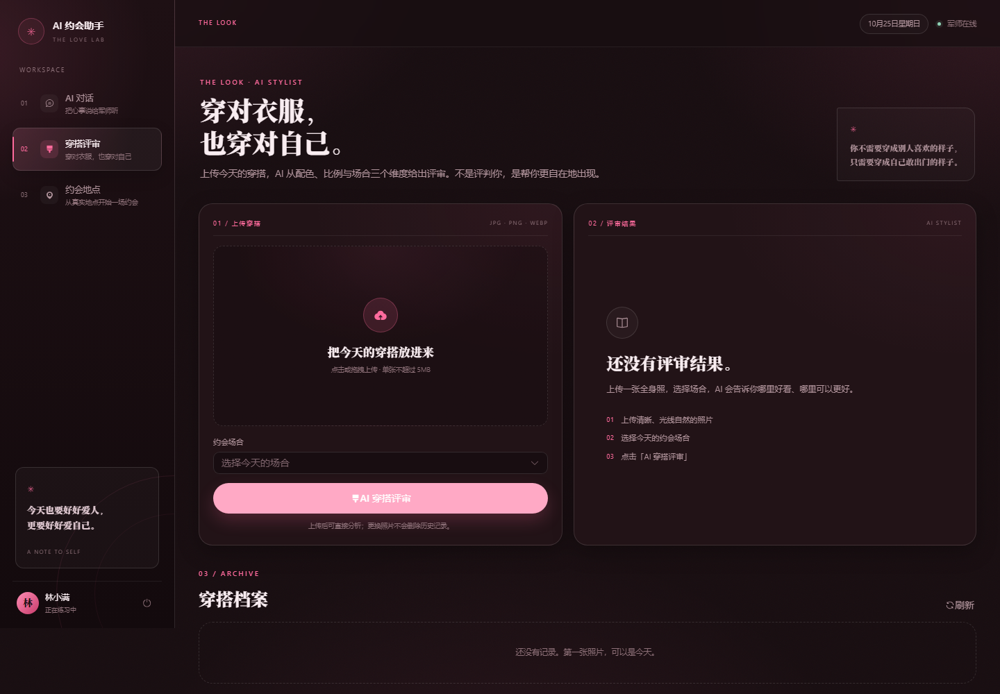
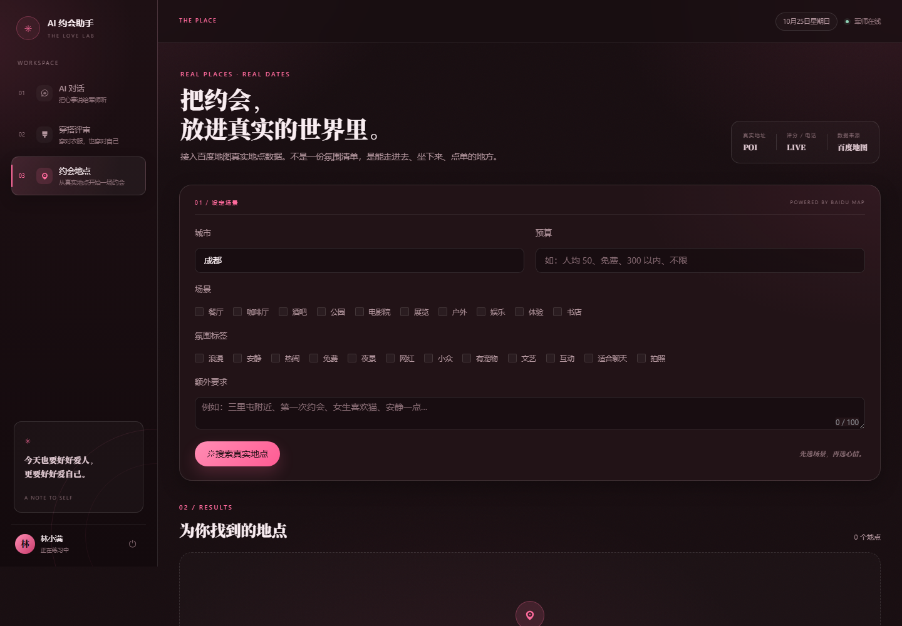

# 💘 AI 约会助手

> 基于 FastAPI + Vue3 的全栈 AI 约会助手应用。集成百度地图真实 POI 检索、LangChain 风格 ReAct 多工具 Agent、GLM-4V 多模态穿搭评价、多人格对话系统，SSE 流式回复。

## ✨ 核心功能

| 功能 | 技术实现 |
|------|---------|
| 🗺️ 真实地点推荐 | 接入百度地图 Agent Plan API，搜任意城市真实 POI（地址/电话/评分/评论/经纬度） |
| 🤖 AI 对话 | LangChain 风格 ReAct Agent，自动路由 4 个工具（地点检索/天气/穿搭/方案规划） |
| 👔 穿搭评价 | GLM-4V 多模态视觉模型，上传照片自动分析穿搭给出建议 |
| 🎭 多人格对话 | 人格档案 MySQL 持久化，对话前动态注入，支持角色切换 |
| ⚡ 流式回复 | Server-Sent Events 实时输出，打字机效果 |
| 🔐 用户系统 | JWT 鉴权 + bcrypt 密码加密 |

## 📸 运行截图

### 1. 登录 / 注册（深色玫瑰）
  

### 2. AI 对话


### 3. 穿搭评价


### 4. 约会地点推荐


## 🏗️ 架构

```
Vue3 前端 ──HTTP/SSE──▶ FastAPI 后端 ──▶ 智谱 GLM-4 LLM
                            │
                            ├──▶ ReAct Agent（4 工具循环）
                            │      ├── 百度地图 place API（真实 POI）
                            │      ├── wttr.in 天气
                            │      ├── GLM-4V 穿搭分析
                            │      └── 约会方案规划
                            │
                            ├──▶ MySQL（用户/人格/对话/穿搭记录）
                            └──▶ JWT 鉴权
```

## 🛠️ 技术栈

**后端**：Python 3.10+、FastAPI、SQLAlchemy、PyJWT、bcrypt、httpx

**前端**：Vue3、Element Plus、Pinia、Vite、Axios

**AI**：智谱 GLM-4 / GLM-4V、LangChain 风格 ReAct Agent

**外部 API**：百度地图 Agent Plan（真实 POI 检索 + 地图可视化）

**数据库**：MySQL（用户/人格档案/对话历史/穿搭记录）

## 📦 项目结构

```
约会系统/
├── core/                   # 核心模块
│   ├── agent.py            # ReAct Agent 循环
│   ├── llm_client.py       # 智谱 LLM 客户端
│   ├── vision_client.py    # GLM-4V 视觉客户端
│   ├── baidu_map_client.py # 百度地图 API 封装
│   ├── persona.py          # 人格系统
│   └── tools.py            # Agent 工具集
├── models/                 # 数据模型
│   ├── user.py
│   ├── persona.py
│   ├── chat.py
│   └── date_spot.py        # 穿搭图片记录
├── routers/                # API 路由
│   ├── auth.py             # 登录注册
│   ├── chat.py             # 对话（SSE 流式）
│   ├── outfit.py           # 穿搭分析
│   ├── spots.py            # 地点推荐
│   └── personas.py         # 人格管理
├── frontend/               # Vue3 前端
│   └── src/
│       ├── views/          # 4 个页面
│       ├── api/            # 接口封装
│       └── stores/         # Pinia 状态
├── screenshots/            # 运行截图
├── main.py                 # 入口
├── config.py               # 配置
├── database.py             # 数据库初始化
├── security.py             # JWT 鉴权
└── requirements.txt
```

## 🚀 本地运行

### 1. 克隆仓库
```bash
git clone https://github.com/你的用户名/ai-date-assistant.git
cd ai-date-assistant
```

### 2. 后端配置
```bash
# 安装依赖
pip install -r requirements.txt

# 复制环境变量模板并填写
cp .env.example .env
# 编辑 .env 填入你的密钥：
#   ZHIPU_API_KEY       - 智谱 API Key
#   MYSQL_PASSWORD      - MySQL 密码
#   BAIDU_MAP_AUTH_TOKEN - 百度地图 Agent Plan token
```

### 3. 数据库
确保 MySQL 已启动，数据库 `ai_date_assistant` 会在首次启动时自动创建。

### 4. 启动后端
```bash
python main.py
# 后端运行在 http://localhost:8080
```

### 5. 前端开发模式（可选）
```bash
cd frontend
npm install
npm run dev      # 开发模式 http://localhost:5173
npm run build    # 构建生产版本到 frontend/dist
```

后端启动后会自动托管 `frontend/dist`，直接访问 http://localhost:8080 即可。

## 🔑 需要申请的 Key

| 服务 | 申请地址 | 用途 |
|------|---------|------|
| 智谱 AI | https://open.bigmodel.cn | GLM-4 对话 + GLM-4V 视觉 |
| 百度地图 | https://lbs.baidu.com/apiconsole/agentplan | 真实 POI 检索 |

## 📄 License

MIT
